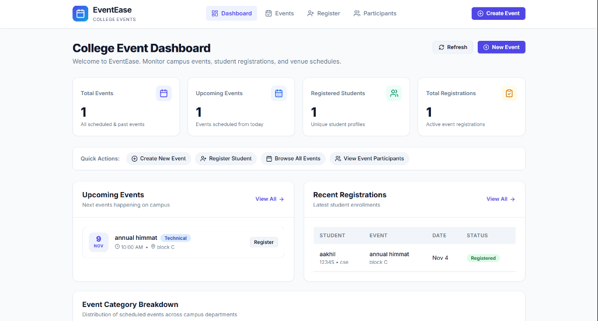
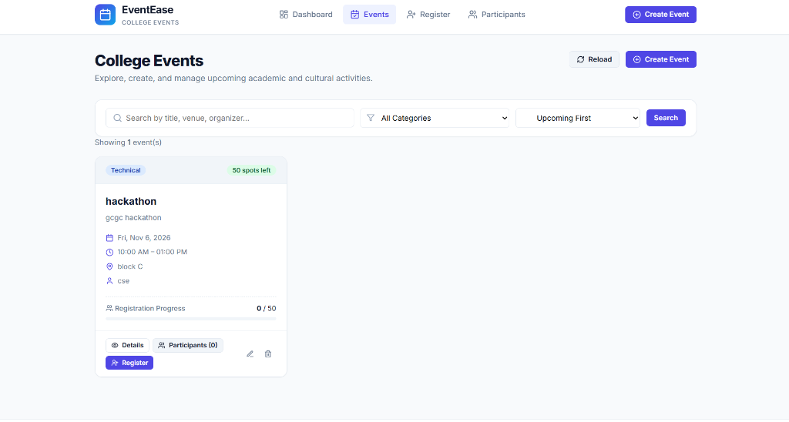
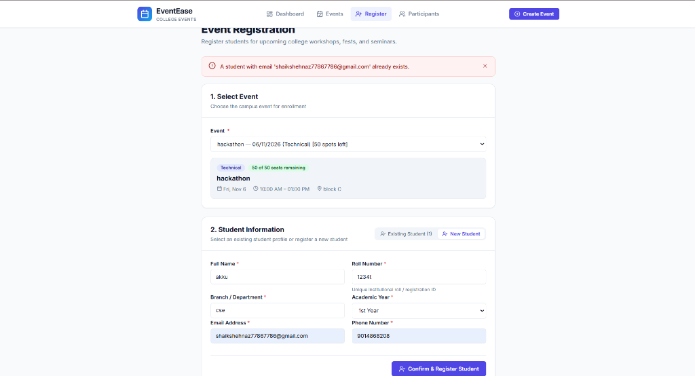
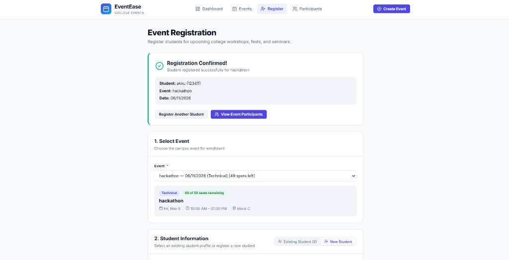
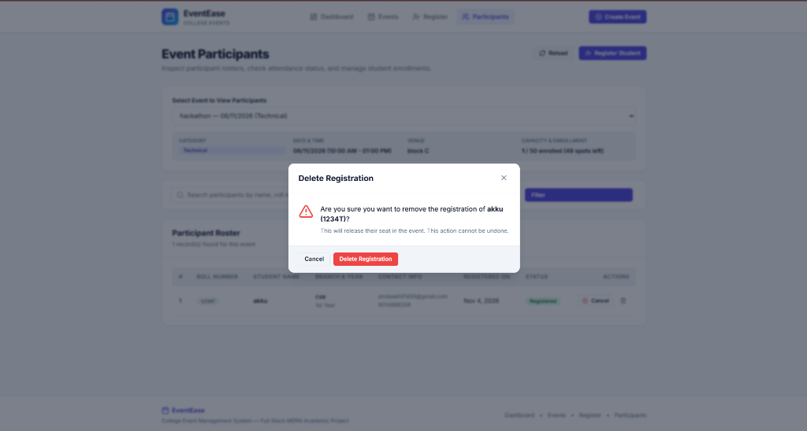

# GITAM SCHOOL OF COMPUTER SCIENCE AND ENGINEERING
### Visakhapatnam

---

# PROJECT REPORT
## EVENTEASE
### College Event Management System

**Submitted by:**  
**Shaik Mahammed Aakhil – 2024049393**  

**Department of Computer Science and Engineering**  
**Branch:** Computer Science and Engineering (CSE)  
**Academic Year:** [2025–2026]

---

## TABLE OF CONTENTS

| Chapter | Title | Page No. |
| :---: | :--- | :---: |
| **1** | Problem Statement and Requirement Analysis | 3 |
| **2** | ReactJS Frontend Development | 6 |
| **3** | NodeJS and ExpressJS Backend Development | 17 |
| **4** | MongoDB Integration and CRUD Operations | 28 |
| **5** | Git and GitHub Implementation | 36 |
| **6** | Cloud Deployment | 41 |
| **7** | Application Testing | 47 |
| **8** | Conclusion | 54 |

---

# Chapter 1: Problem Statement and Requirement Analysis

## 1.1 Problem Statement
Managing college events, technical symposiums, cultural fests, workshops, and seminars is an integral part of campus life in educational institutions. Traditionally, event announcements, student registrations, participant roster tracking, and seat allocation are handled manually using spreadsheets, paper forms, or fragmented instant-messaging groups. 

This traditional manual process poses significant challenges:
1. **Capacity Overflows and Unchecked Bookings:** Organizers frequently face over-capacity registrations due to lack of real-time seat counters, leading to venue overcrowding or sudden last-minute rejections.
2. **Duplicate Registrations:** Students often submit multiple forms, leading to skewed headcount estimates and inefficient resource allocation.
3. **Scattered Information:** Details regarding venues, timing schedules, department organizers, and category classifications are difficult for students to browse and search centrally.
4. **Administrative Overhead:** Event coordinators spend hours compiling participant rosters, tracking cancellations, and manually cross-verifying student roll numbers and department credentials.

**EventEase — College Event Management System** is a full-stack web application developed to centralize and automate event administration across campus. It provides a real-time dashboard, categorized event browsing, instant seat capacity tracking, student registration with duplicate-prevention logic, and event-specific participant rosters.

## 1.2 Requirement Analysis

### Functional Requirements
- **Dashboard Overview:** Display aggregate metric cards (Total Events, Upcoming Events, Registered Students, Active Registrations), an upcoming events schedule, and real-time recent registrations.
- **Event Management (CRUD):** Enable organizers to create, view, edit, and delete events with fields for title, category, description, venue, date, time slots, student capacity, and organizing department.
- **Search and Category Filtering:** Enable students to search events by keyword (title, venue, organizer) and filter by categories (Technical, Cultural, Sports, Workshop, Seminar, Academic, Other).
- **Student Profile Management:** Maintain student records with validated fields including Name, unique Roll Number, Department/Branch, Academic Year, unique Email, and Contact Phone.
- **Seat Capacity Enforcement:** Automatically track enrolled students versus total capacity, calculate seats remaining, display real-time status badges (*Available* or *Capacity Full*), and block new enrollments when an event reaches maximum capacity.
- **Duplicate Registration Prevention:** Prevent students from registering more than once for the same event using a composite unique constraint at both controller and database levels.
- **Participant Roster Tracking:** Allow organizers to inspect event-specific participant rosters, filter by status (*Registered* or *Cancelled*), toggle student attendance status, and cancel or delete registrations to release seats.
- **Centralized Error Handling & Health Monitoring:** Provide clear API health verification endpoints (`/api/health`) and structured JSON error responses with standard HTTP status codes.

### Non-Functional Requirements
- **Usability:** Clean, responsive, and intuitive user interface designed for college students and faculty coordinators.
- **Performance:** Fast response times using lightweight REST APIs, Mongoose indexing, and optimized React component re-rendering.
- **Data Integrity:** Strict schema validation rules, unique roll numbers/emails, and cascading deletes to prevent orphaned records when an event is deleted.
- **Maintainability:** Clear separation of concerns following MVC architecture (Models, Views/React Pages, Controllers, Routes, Middleware).
- **Cross-Platform Compatibility:** Responsive layout supporting desktops, laptops, tablets, and mobile smartphones.
- **Reliability:** Graceful error handling for database connection drops with immediate `503 Service Unavailable` notifications rather than application crashes.

## 1.3 Technology Requirements

| Component | Technology / Tool | Version / Details |
| :--- | :--- | :--- |
| **Frontend Framework** | React.js | v18.3.1 (Vite Build Tool v6.1) |
| **Client Routing** | React Router DOM | v6.28.0 |
| **HTTP Client** | Axios | v1.7.9 (Centralized interceptors) |
| **UI Icons & Styling** | Lucide React & Modern Responsive CSS | CSS3 Variables, Flexbox, CSS Grid |
| **Backend Runtime** | Node.js | v18+ / v20+ / v24+ |
| **Backend Framework** | Express.js | v5.3.0 |
| **Database** | MongoDB & Mongoose ODM | Mongoose v9.11.2 (Local MongoDB 9.0 / Atlas) |
| **API Testing** | Postman | `EventEase.postman_collection.json` |
| **Version Control** | Git & GitHub | Distributed version control |
| **Deployment Target** | Render (Backend) / GitHub Pages or Vercel (Frontend) | Cloud-hosted PaaS |

## 1.4 Expected Outcome
The completed EventEase system provides an end-to-end, paperless campus event management platform. Administrators can publish and manage events effortlessly, students can enroll in campus workshops with instantaneous capacity validation, and faculty coordinators have instant access to real-time participant rosters and attendance statuses.

---

# Chapter 2: ReactJS Frontend Development

## 2.1 Introduction to ReactJS
React.js is a component-based open-source JavaScript library developed by Meta for building dynamic and interactive single-page user interfaces (SPAs). React utilizes a Virtual DOM (Document Object Model) to efficiently calculate interface diffs and re-render only the modified UI components, resulting in exceptional application performance and responsiveness.

In **EventEase**, React.js is utilized alongside **Vite** and **React Router v6** to provide a seamless five-page navigation experience without full-page browser refreshes.

## 2.2 Objectives of Frontend Development
- To build a clean, modern, and accessible user interface tailored for college campus usage.
- To implement declarative client-side routing across the five core application views.
- To present real-time summary statistics, upcoming event spotlights, and recent registrations on the Dashboard.
- To provide intuitive search and category filtering for events.
- To build robust forms with client-side validation for event creation and student registration.
- To display event rosters with one-click registration cancellation, re-activation, and record deletion.
- To implement responsive styling that adapts seamlessly to desktop, tablet, and mobile screens.

## 2.3 Technologies Used in Frontend

| Technology | Purpose |
| :--- | :--- |
| **React.js (v18.3)** | Core UI library for component composition and state handling. |
| **React Router v6** | Declarative client-side routing across pages (`/`, `/events`, `/register`, etc.). |
| **Axios** | Promised-based HTTP client with request/response interceptors for REST communication. |
| **Lucide React** | Modern, lightweight SVG icon package for clean visual indicators. |
| **CSS3 Design System** | Custom styling with CSS custom properties (variables), Grid, and Flexbox. |
| **Vite** | Fast Next-Generation frontend build tool and local development server. |

## 2.4 Frontend Project Structure
The frontend application maintains a clean, modular structure with minimal file clutter:

```text
frontend/
├── src/
│   ├── components/          # Reusable UI building blocks
│   │   ├── EmptyState.jsx   # Zero-data display with contextual action buttons
│   │   ├── EventCard.jsx    # Card presentation with capacity progress indicator
│   │   ├── FormField.jsx    # Reusable validated inputs, textareas, and select menus
│   │   ├── LoadingSpinner.jsx # Smooth async loading spinner
│   │   ├── Modal.jsx        # Accessible popup dialog for confirmations
│   │   ├── Navbar.jsx       # Responsive top navigation with mobile drawer
│   │   ├── Notification.jsx # Auto-dismissing success/error toast alerts
│   │   └── StatCard.jsx     # Dashboard metric highlight card
│   ├── pages/               # Five core college guidelines pages
│   │   ├── Dashboard.jsx    # 1. Main statistics, upcoming events, recent registrations
│   │   ├── EventsList.jsx   # 2. Event catalogue with search, category filter, and sorting
│   │   ├── EventForm.jsx    # 3. Create & Edit event form with validation
│   │   ├── StudentRegistration.jsx # 4. Student enrollment form with capacity guard
│   │   └── Participants.jsx # 5. Event participant roster & status management
│   ├── services/
│   │   └── api.js           # Centralized Axios API client configuration
│   ├── App.jsx              # Main router definition and app shell layout
│   ├── main.jsx             # React DOM root entry point
│   └── styles.css           # Global stylesheet and responsive media queries
├── .env                     # VITE_API_URL=http://localhost:5000/api
├── index.html               # Single page application HTML template
├── package.json             # Frontend dependencies and scripts
└── vite.config.js           # Vite development server configuration
```

## 2.5 Design of the User Interface

The EventEase frontend comprises five core functional views:

### 2.5.1 Top Navigation Bar (`Navbar.jsx`)
Features the application brand logo, direct navigation links to the four main sections (Dashboard, Events, Register, Participants), an elevated "Create Event" quick-action button, and a responsive hamburger drawer for mobile viewports.

### 2.5.2 Dashboard Page (`Dashboard.jsx`)
The central landing view featuring:
- **Four Key Metric Cards:** Total Events, Upcoming Events, Registered Students, and Total Registrations.
- **Quick Action Pills:** One-click shortcuts to create events, register students, or browse listings.
- **Two-Column Split Layout:** An "Upcoming Events" timeline on the left and a "Recent Registrations" tabular feed on the right.
- **Departmental Category Breakdown:** Visual pill badges indicating event distribution across technical, cultural, and sports categories.

### 2.5.3 Events List Page (`EventsList.jsx`)
An interactive event catalogue featuring:
- A search input filtering simultaneously by title, venue, organizer, and description.
- A category dropdown selector (*All, Technical, Cultural, Sports, Workshop, Seminar, Academic, Other*).
- Sorting controls (*Upcoming First, Recently Created, Alphabetical*).
- Event cards displaying date badges, category tags, location metadata, capacity progress bars, details modal, and Edit/Delete controls.

### 2.5.4 Create / Edit Event Page (`EventForm.jsx`)
A unified, validated form supporting both event creation (`/events/create`) and modification (`/events/edit/:id`). Form fields include Event Title, Description, Category, Venue, Date, Start Time, End Time, Seat Capacity, and Organizing Department.

### 2.5.5 Student Registration Page (`StudentRegistration.jsx`)
A streamlined enrollment portal featuring:
- Event selector displaying real-time seats remaining.
- Visual summary banner showing category, timings, venue, and full-capacity alert.
- Two enrollment modes: selecting an existing registered student or enrolling a new student profile on the fly.
- Form validation preventing submissions when seats are exhausted or fields are missing.

### 2.5.6 Event Participants Page (`Participants.jsx`)
A dedicated participant roster view enabling organizers to:
- Select an event from a dropdown list to view all registered students.
- Search participants by roll number, name, branch, or email.
- Filter attendees by status (*All, Registered, Cancelled*).
- Toggle student status between *Registered* and *Cancelled* with one click.
- Permanently remove registrations to release seats back to the event pool.

## 2.6 React Components and State Management
EventEase uses standard React functional components with React Hooks (`useState`, `useEffect`, `useParams`, `useSearchParams`).

### 2.6.1 React Router Navigation Configuration (`src/App.jsx`)
The application defines client-side routes within `App.jsx`, mapping URL paths to the five core view components inside a persistent navigation shell:

```jsx
import React from 'react';
import { Routes, Route, Navigate } from 'react-router-dom';
import Navbar from './components/Navbar';
import Dashboard from './pages/Dashboard';
import EventsList from './pages/EventsList';
import EventForm from './pages/EventForm';
import StudentRegistration from './pages/StudentRegistration';
import Participants from './pages/Participants';

function App() {
  return (
    <div className="app-layout">
      {/* Persistent Navigation Bar */}
      <Navbar />

      {/* Declarative View Routing */}
      <main className="main-content-area">
        <Routes>
          <Route path="/" element={<Dashboard />} />
          <Route path="/events" element={<EventsList />} />
          <Route path="/events/create" element={<EventForm />} />
          <Route path="/events/edit/:id" element={<EventForm />} />
          <Route path="/register" element={<StudentRegistration />} />
          <Route path="/participants" element={<Participants />} />
          <Route path="*" element={<Navigate to="/" replace />} />
        </Routes>
      </main>
    </div>
  );
}

export default App;
```

### 2.6.2 Reusable Event Card Component (`src/components/EventCard.jsx`)
`EventCard.jsx` encapsulates event details, category badge indicators, and dynamic seat capacity progress calculation:

```jsx
const EventCard = ({ event, onViewDetails, onEdit, onDelete }) => {
  const { title, category, venue, eventDate, capacity, registeredCount = 0, seatsLeft = 0, isFull } = event;

  const formattedDate = new Date(eventDate).toLocaleDateString('en-US', {
    weekday: 'short', month: 'short', day: 'numeric', year: 'numeric'
  });

  // Calculate percentage of occupied seats
  const percentFilled = Math.min(100, Math.round((registeredCount / capacity) * 100));

  return (
    <div className="event-card">
      <div className="event-card-header">
        <span className={`badge badge-${category.toLowerCase()}`}>{category}</span>
        {isFull ? (
          <span className="badge badge-danger">Capacity Full</span>
        ) : (
          <span className="badge badge-success">{seatsLeft} spots left</span>
        )}
      </div>
      <div className="event-card-body">
        <h3 className="event-title">{title}</h3>
        <p className="event-meta">📍 {venue} • 🗓️ {formattedDate}</p>
        <div className="capacity-bar-container">
          <div className="capacity-bar" style={{ width: `${percentFilled}%` }} />
        </div>
        <span className="capacity-text">{registeredCount} / {capacity} registered</span>
      </div>
    </div>
  );
};
```

### 2.6.3 Local Component State Architecture
Component states track asynchronous network requests, form inputs, modal visibility, and client-side validation errors:

```jsx
// Example from StudentRegistration.jsx
const [events, setEvents] = useState([]);
const [students, setStudents] = useState([]);
const [selectedEventId, setSelectedEventId] = useState('');
const [studentMode, setStudentMode] = useState('existing'); // 'existing' or 'new'
const [loading, setLoading] = useState(true);
const [submitting, setSubmitting] = useState(false);
const [validationErrors, setValidationErrors] = useState({});
```

## 2.7 Loading Data with `useEffect` and Centralized API Service
Data fetching is executed on component mount via `useEffect` hooks calling methods from `api.js`:

```javascript
// Centralized Axios API configuration (src/services/api.js)
import axios from 'axios';

const API_BASE_URL = import.meta.env.VITE_API_URL || 'http://localhost:5000/api';

const api = axios.create({
  baseURL: API_BASE_URL,
  headers: { 'Content-Type': 'application/json' },
  timeout: 10000
});

// Response interceptor to format clean error messages
api.interceptors.response.use(
  (response) => response,
  (error) => {
    let message = 'An unexpected error occurred. Please verify backend is running.';
    if (error.response && error.response.data && error.response.data.message) {
      message = error.response.data.message;
    } else if (error.message) {
      message = error.message;
    }
    return Promise.reject(new Error(message));
  }
);
```

```jsx
// Initial data loading inside Dashboard.jsx
useEffect(() => {
  const fetchDashboardStats = async () => {
    try {
      setLoading(true);
      setError(null);
      const res = await dashboardService.getStats();
      if (res.success) {
        setStats(res.data);
      }
    } catch (err) {
      setError(err.message);
    } finally {
      setLoading(false);
    }
  };
  fetchDashboardStats();
}, []);
```

## 2.8 Student Registration Submission Flow
When a user submits an event registration, the frontend validates inputs, sends a `POST` request to `/api/registrations`, and updates the UI state:

```javascript
// Registration submission handler in StudentRegistration.jsx
const handleSubmit = async (e) => {
  e.preventDefault();
  if (selectedEvent?.isFull) {
    setApiError('This event is already at maximum capacity.');
    return;
  }

  try {
    setSubmitting(true);
    let targetStudentId = selectedStudentId;

    if (studentMode === 'new') {
      if (!validateNewStudent()) return;
      const studentRes = await studentService.create({
        ...newStudent,
        rollNo: newStudent.rollNo.toUpperCase().trim(),
        email: newStudent.email.toLowerCase().trim()
      });
      targetStudentId = studentRes.data._id;
    }

    const regRes = await registrationService.create({
      eventId: selectedEventId,
      studentId: targetStudentId,
      status: 'Registered'
    });

    if (regRes.success) {
      setSuccessData({ registration: regRes.data, message: regRes.message });
      const updatedEvents = await eventService.getAll();
      if (updatedEvents.success) setEvents(updatedEvents.data);
    }
  } catch (err) {
    setApiError(err.message || 'Failed to register student');
  } finally {
    setSubmitting(false);
  }
};
```

## 2.9 Form Validation and Feedback Mechanisms
The frontend enforces strict field verification before dispatching network calls:
- Non-empty constraints for required fields with clear red indicator labels.
- Email format validation using regular expressions (`/^\S+@\S+\.\S+$/`).
- 10-digit mobile number format validation (`/^\d{10}$/`).
- Capacity lower bound enforcement (`capacity >= 1`).
- Dynamic banner alerts informing users when an event is full or when a duplicate entry is attempted.

## 2.10 Responsive CSS Styling
The visual design in `styles.css` uses modern CSS3 variables and responsive media breakpoints:
- **`@media (max-width: 1024px)`:** Two-column grid layouts for statistic metric cards and participant summaries.
- **`@media (max-width: 768px)`:** Desktop navigation collapses into an animated mobile drawer; event grids and form rows transition into a stacked single-column flow.
- **`@media (max-width: 480px)`:** Full-width action buttons and card layouts optimized for single-hand mobile interactions.

---

# Chapter 3: NodeJS and ExpressJS Backend Development

## 3.1 Introduction to NodeJS
Node.js is a cross-platform, open-source JavaScript runtime environment built on Google Chrome's V8 engine. Node.js uses an asynchronous, non-blocking, event-driven I/O model, allowing it to efficiently handle thousands of concurrent client requests with minimal system overhead. In EventEase, Node.js powers the server-side REST API application.

## 3.2 Introduction to ExpressJS
Express.js is a lightweight, flexible web application framework for Node.js. It simplifies HTTP request routing, middleware composition, request parsing, and response formatting, making it the industry standard for developing robust RESTful APIs.

## 3.3 Objectives of Backend Development
- To construct a modular, maintainable RESTful web API using Express.js.
- To establish a reliable, auto-reconnecting database layer with MongoDB and Mongoose.
- To implement complete CRUD operations for Events, Students, Registrations, and Dashboard summaries.
- To strictly enforce business rules: unique roll numbers/emails, maximum capacity limits, and duplicate enrollment blocks.
- To handle database outages gracefully with immediate `503 Service Unavailable` status responses.
- To provide centralized error handling middleware and automated parameter validation.

## 3.4 Backend Project Structure

```text
backend/
├── config/
│   └── db.js                    # MongoDB connection configuration with Mongoose
├── controllers/
│   ├── dashboardController.js   # Analytics aggregation & summary counts
│   ├── eventController.js       # Event CRUD operations & capacity calculations
│   ├── registrationController.js# Registration CRUD, duplicate & capacity checks
│   └── studentController.js     # Student profile management & enrollment history
├── middleware/
│   ├── errorHandler.js          # Centralized error handler middleware
│   └── validate.js              # Mongoose ObjectId parameter validator
├── models/
│   ├── Event.js                 # Event schema definition
│   ├── Registration.js          # Registration schema with composite unique index
│   └── Student.js               # Student schema with unique rollNo & email
├── routes/
│   ├── dashboardRoutes.js       # Dashboard router (/api/dashboard)
│   ├── eventRoutes.js           # Event router (/api/events)
│   ├── registrationRoutes.js    # Registration router (/api/registrations)
│   └── studentRoutes.js         # Student router (/api/students)
├── .env                         # Server port and MongoDB connection URI
├── .env.example                 # Template for local and cloud environment variables
├── package.json                 # Backend dependencies, metadata, and scripts
└── server.js                    # Application entry point, middleware, and route mounting
```

## 3.5 Backend Technologies Used

| Technology | Purpose |
| :--- | :--- |
| **Node.js** | Server-side runtime environment executing JavaScript. |
| **Express.js (v5.3)** | Web application framework for routing and middleware orchestration. |
| **Mongoose (v9.11)** | Object Data Modeling (ODM) library for MongoDB data validation and relationships. |
| **CORS** | Cross-Origin Resource Sharing middleware enabling requests from the React frontend. |
| **dotenv** | Loads environment configurations from `.env` into `process.env`. |
| **nodemon** | Development utility automatically restarting the server upon code changes. |

## 3.6 Server Configuration (`server.js`)
The server initializes environment variables, applies CORS headers, parses JSON request payloads, checks database connectivity, and mounts routes:

```javascript
require('dotenv').config();
const express = require('express');
const cors = require('cors');
const mongoose = require('mongoose');

const connectDB = require('./config/db');
const errorHandler = require('./middleware/errorHandler');

const eventRoutes = require('./routes/eventRoutes');
const studentRoutes = require('./routes/studentRoutes');
const registrationRoutes = require('./routes/registrationRoutes');
const dashboardRoutes = require('./routes/dashboardRoutes');

const app = express();

app.use(cors({ origin: '*', methods: ['GET', 'POST', 'PUT', 'DELETE', 'OPTIONS'] }));
app.use(express.json());
app.use(express.urlencoded({ extended: true }));

// Health Check Endpoint
app.get('/api/health', (req, res) => {
  const isDbConnected = mongoose.connection.readyState === 1;
  res.status(200).json({
    success: true,
    message: 'EventEase API is live and healthy',
    database: isDbConnected ? 'connected' : 'disconnected',
    timestamp: new Date().toISOString()
  });
});

// Guard Middleware: Fast-fail with 503 if DB is offline
const checkDBConnection = (req, res, next) => {
  if (mongoose.connection.readyState !== 1) {
    return res.status(503).json({
      success: false,
      message: 'Database is currently disconnected. Please verify MongoDB is running.'
    });
  }
  next();
};

app.use('/api/events', checkDBConnection, eventRoutes);
app.use('/api/students', checkDBConnection, studentRoutes);
app.use('/api/registrations', checkDBConnection, registrationRoutes);
app.use('/api/dashboard', checkDBConnection, dashboardRoutes);

app.use(errorHandler);
```

## 3.7 REST API Endpoints Specification

| Method | Endpoint | Description | Status Code |
| :---: | :--- | :--- | :---: |
| `GET` | `/api/health` | System health and database connectivity check | `200` |
| `GET` | `/api/dashboard/stats` | Key metrics, category counts, upcoming events | `200` |
| `GET` | `/api/events` | List events (supports `search`, `category`, `sortBy`) | `200` |
| `POST` | `/api/events` | Create a new campus event | `201` |
| `GET` | `/api/events/:id` | Get event by ID with active registration counts | `200` / `404` |
| `PUT` | `/api/events/:id` | Update event information and seat capacity | `200` / `400` / `404` |
| `DELETE` | `/api/events/:id` | Delete event and cascade delete linked registrations | `200` / `404` |
| `GET` | `/api/students` | Get all students (supports `search`, `branch`, `year`) | `200` |
| `POST` | `/api/students` | Register student (validates unique roll number & email) | `201` / `409` |
| `GET` | `/api/students/:id` | Retrieve student details and registration history | `200` / `404` |
| `PUT` | `/api/students/:id` | Update student profile details | `200` / `409` / `404` |
| `DELETE` | `/api/students/:id` | Delete student and clean up their registrations | `200` / `404` |
| `GET` | `/api/registrations` | List all registrations (supports `eventId`, `status`) | `200` |
| `POST` | `/api/registrations` | Register student (enforces capacity and uniqueness) | `201` / `400` |
| `GET` | `/api/registrations/event/:eventId` | Get participants list for a specific event | `200` / `404` |
| `PUT` | `/api/registrations/:id` | Update status (`Registered` or `Cancelled`) | `200` / `400` / `404` |
| `DELETE` | `/api/registrations/:id` | Delete registration record and release seat | `200` / `404` |

## 3.8 Key Controller & Middleware Implementation

### 3.8.1 Event Registration Controller (`controllers/registrationController.js`)
The registration controller enforces college business rules: validating event and student existence, rejecting duplicate registrations, verifying seat capacity, and populating student credentials:

```javascript
const createRegistration = async (req, res, next) => {
  try {
    const { eventId, studentId, status } = req.body;

    // 1. Verify Event and Student existence
    const event = await Event.findById(eventId);
    if (!event) return res.status(404).json({ success: false, message: 'Event not found' });

    const student = await Student.findById(studentId);
    if (!student) return res.status(404).json({ success: false, message: 'Student not found' });

    // 2. Prevent duplicate active registrations
    const existingRegistration = await Registration.findOne({ eventId, studentId });
    if (existingRegistration && existingRegistration.status === 'Registered') {
      return res.status(400).json({
        success: false,
        message: `Student '${student.name}' (${student.rollNo}) is already registered for '${event.title}'.`
      });
    }

    // 3. Enforce Event Capacity limit
    const activeRegistrations = await Registration.countDocuments({ eventId, status: 'Registered' });
    if (activeRegistrations >= event.capacity) {
      return res.status(400).json({
        success: false,
        message: `Event '${event.title}' has reached maximum capacity of ${event.capacity} seats.`
      });
    }

    // 4. Create new registration document
    const registration = await Registration.create({
      eventId,
      studentId,
      status: status || 'Registered',
      registrationDate: new Date()
    });

    const populatedRegistration = await Registration.findById(registration._id)
      .populate('eventId', 'title category venue eventDate capacity')
      .populate('studentId', 'name rollNo branch year email phone');

    res.status(201).json({
      success: true,
      message: `Student registered successfully for ${event.title}`,
      data: populatedRegistration
    });
  } catch (error) {
    next(error);
  }
};
```

### 3.8.2 Centralized Error Handling Middleware (`middleware/errorHandler.js`)
The error handler intercepts runtime exceptions across all endpoints and converts them into structured HTTP JSON responses:

```javascript
const errorHandler = (err, req, res, next) => {
  let statusCode = res.statusCode === 200 ? 500 : res.statusCode;
  let message = err.message || 'Internal Server Error';

  // Handle Mongoose Bad ObjectId (CastError)
  if (err.name === 'CastError') {
    statusCode = 400;
    message = `Invalid ID format for ${err.path}: ${err.value}`;
  }

  // Handle Mongoose Schema Validation Errors
  if (err.name === 'ValidationError') {
    statusCode = 400;
    message = Object.values(err.errors).map((e) => e.message).join(', ');
  }

  // Handle MongoDB Unique Index Conflict (E11000)
  if (err.code === 11000) {
    statusCode = 409;
    const duplicateFields = Object.keys(err.keyValue || {}).join(', ');
    message = `A record with this ${duplicateFields} already exists. Please use unique details.`;
  }

  // Handle MongoDB Connection / ServerSelectionError
  if (err.name === 'MongooseServerSelectionError' || (err.message && err.message.includes('buffering timed out'))) {
    statusCode = 503;
    message = 'Database is currently unreachable. Please verify MongoDB service is active.';
  }

  res.status(statusCode).json({
    success: false,
    message,
    stack: process.env.NODE_ENV === 'production' ? null : err.stack
  });
};

module.exports = errorHandler;
```

---

# Chapter 4: MongoDB Integration and CRUD Operations

## 4.1 Introduction to MongoDB
MongoDB is a leading NoSQL document-oriented database known for its high scalability, flexible BSON (Binary JSON) schema design, and powerful querying capabilities. Unlike relational databases requiring rigid schema tables and foreign key joins, MongoDB models data naturally as self-contained documents within collections.

## 4.2 Database Collections Structure
EventEase uses three MongoDB collections:

| Collection Name | Model File | Purpose |
| :--- | :--- | :--- |
| **`events`** | `models/Event.js` | Stores college event details, schedules, venues, and capacity limits. |
| **`students`** | `models/Student.js` | Stores student profiles, academic years, unique roll numbers, and contact information. |
| **`registrations`** | `models/Registration.js` | Stores registration records linking students to events with enrollment dates and statuses. |

## 4.3 Mongoose Schemas & Duplicate Prevention Index

```javascript
// Event Schema
const eventSchema = new mongoose.Schema({
  title: { type: String, required: true, trim: true },
  description: { type: String, required: true },
  category: { type: String, required: true, enum: ['Technical', 'Cultural', 'Sports', 'Workshop', 'Seminar', 'Academic', 'Other'], default: 'Technical' },
  venue: { type: String, required: true },
  eventDate: { type: Date, required: true },
  startTime: { type: String, required: true },
  endTime: { type: String, required: true },
  capacity: { type: Number, required: true, min: 1 },
  organizer: { type: String, required: true }
}, { timestamps: true });

// Student Schema with Unique Roll No & Email
const studentSchema = new mongoose.Schema({
  name: { type: String, required: true },
  rollNo: { type: String, required: true, unique: true, uppercase: true },
  branch: { type: String, required: true },
  year: { type: String, required: true, enum: ['1st Year', '2nd Year', '3rd Year', '4th Year'] },
  email: { type: String, required: true, unique: true, lowercase: true },
  phone: { type: String, required: true }
}, { timestamps: true });

// Registration Schema with Compound Unique Constraint
const registrationSchema = new mongoose.Schema({
  eventId: { type: mongoose.Schema.Types.ObjectId, ref: 'Event', required: true },
  studentId: { type: mongoose.Schema.Types.ObjectId, ref: 'Student', required: true },
  registrationDate: { type: Date, default: Date.now },
  status: { type: String, enum: ['Registered', 'Cancelled'], default: 'Registered' }
}, { timestamps: true });

// Ensures a student can register only once per event
registrationSchema.index({ eventId: 1, studentId: 1 }, { unique: true });
```

## 4.4 MongoDB Connection & Graceful Reconnection (`config/db.js`)
The database connection module initializes Mongoose with connection pooling and an aggressive `serverSelectionTimeoutMS: 5000` to prevent application hangs during database cold starts:

```javascript
const mongoose = require('mongoose');

const connectDB = async () => {
  try {
    const mongoURI = process.env.MONGODB_URI || 'mongodb://127.0.0.1:27017/eventease';
    
    const conn = await mongoose.connect(mongoURI, {
      serverSelectionTimeoutMS: 5000
    });

    console.log(`[EventEase Database] MongoDB Connected: ${conn.connection.host}/${conn.connection.name}`);
  } catch (error) {
    console.error(`[EventEase Database Error] Failed to connect: ${error.message}`);
    console.warn(`[EventEase Database Tip] Make sure MongoDB is running or configure MONGODB_URI in backend/.env.`);
  }
};

module.exports = connectDB;
```

## 4.5 MongoDB Aggregation and Cascading Cleanup Logic

### 4.5.1 Category Distribution Aggregation (`controllers/dashboardController.js`)
MongoDB's native aggregation pipeline groups events by department category to render category distribution tags on the dashboard:

```javascript
const categoryStats = await Event.aggregate([
  {
    $group: {
      _id: '$category',
      count: { $sum: 1 }
    }
  },
  { $sort: { count: -1 } }
]);
```

### 4.5.2 Cascading Delete of Linked Registrations (`controllers/eventController.js`)
When an event is deleted, EventEase executes a cascading cleanup to ensure orphaned registration records do not persist in the database:

```javascript
const deleteEvent = async (req, res, next) => {
  try {
    const event = await Event.findById(req.params.id);
    if (!event) return res.status(404).json({ success: false, message: 'Event not found' });

    // Cascade delete all associated registrations
    await Registration.deleteMany({ eventId: event._id });
    await event.deleteOne();

    res.status(200).json({
      success: true,
      message: `Event '${event.title}' and associated registrations deleted successfully`
    });
  } catch (error) {
    next(error);
  }
};
```

---

# Chapter 5: Git and GitHub Implementation

## 5.1 Introduction to Git and GitHub
**Git** is a distributed version control system designed to record changes to project files over time, enabling seamless branching, rollback, and team collaboration. **GitHub** is a cloud-based repository hosting platform providing backup, code review, issue tracking, and automated deployment integrations.

## 5.2 Version Control Workflow
1. **Working Directory:** Files are created and edited in local workspace.
2. **Staging Area (`git add`):** Modified files are staged, excluding build artifacts and sensitive keys via `.gitignore`.
3. **Local Commit (`git commit`):** Staged changes are packaged with descriptive commit messages.
4. **Remote Push (`git push`):** Changes are uploaded to the GitHub repository.

## 5.3 Essential Git Commands

```powershell
# 1. Initialize local repository
git init

# 2. Check status
git status

# 3. Stage source files
git add .

# 4. Commit changes
git commit -m "EventEase College Event Management System implementation"

# 5. Push to GitHub
git branch -M main
git remote add origin https://github.com/akki07-hub/eventease.git
git push -u origin main
```

---

# Chapter 6: Cloud Deployment

## 6.1 Cloud Architecture
EventEase follows a decoupled cloud deployment architecture:

```text
 ┌───────────────────────┐            REST API Calls            ┌───────────────────────┐
 │     Frontend UI       │  ──────────────────────────────────> │    Backend Service    │
 │ (Vercel/GitHub Pages) │  <────────────────────────────────── │     (Render.com)      │
 └───────────────────────┘            JSON Responses            └───────────┬───────────┘
                                                                            │
                                                                   Mongoose Connection
                                                                            │
                                                                            ▼
                                                                ┌───────────────────────┐
                                                                │     MongoDB Atlas     │
                                                                │  (Cloud M0 Cluster)   │
                                                                └───────────────────────┘
```

## 6.2 Deployment Configuration
1. **Database:** MongoDB Atlas M0 Cluster with connection string:
   `mongodb+srv://<username>:<password>@cluster0.mongodb.net/eventease?retryWrites=true&w=majority`
2. **Backend:** Deployed on Render with Build Command `npm install` and Start Command `node server.js`.
3. **Frontend:** Deployed on Vercel with Environment Variable `VITE_API_URL=https://[backend-url].onrender.com/api`.

---

# Chapter 7: Application Testing

## 7.1 Introduction
Application testing is an essential phase of software development that validates whether the system behaves according to design specifications. In **EventEase**, comprehensive testing was performed across the React frontend, Express.js backend, and MongoDB database to verify event creation, capacity allocation, duplicate registration prevention, and participant management.

## 7.2 Objectives of Testing
- To confirm that the application dashboard accurately displays live metrics from the database.
- To verify that new campus events can be created, searched, and filtered.
- To validate that duplicate student registrations (by existing email or roll number) are caught and rejected with clear error messages.
- To verify that student enrollments are recorded accurately and seats are reserved.
- To verify that participant deletion modals safeguard against accidental data loss.

## 7.3 Test Cases

The following five primary test scenarios were executed to evaluate the EventEase application:

| Test Case ID | Test Scenario | Expected Result | Actual Result | Status |
| :---: | :--- | :--- | :--- | :---: |
| **TC01** | **Dashboard Loading & Metrics Overview** | Dashboard loads with live counts (Total Events, Upcoming Events, Registered Students, Active Registrations), upcoming events timeline, and recent registrations table. | Dashboard loaded with 1 event, 1 registered student, and accurate summary cards. | **[Pass]** |
| **TC02** | **Event Catalogue & Filtering** | Events list displays scheduled events with category badges, seats remaining progress bar, search input, and action buttons. | Event card displayed "hackathon" with "Technical" badge and "50 spots left". | **[Pass]** |
| **TC03** | **Input Validation & Duplicate Prevention** | System detects existing student credentials (email/roll number) and halts submission with an informative error alert banner. | Displayed red alert: *"A student with email 'shaikshehnaz77867786@gmail.com' already exists."* | **[Pass]** |
| **TC04** | **Student Registration Confirmation** | System registers student, decrements available seats by 1, and displays a green confirmation card with student and event details. | Displayed green card: *"Registration Confirmed! Student registered successfully for hackathon"*. | **[Pass]** |
| **TC05** | **Participant Roster & Registration Deletion** | Organizers can inspect registered participants and open an interactive confirmation modal before deleting a registration record. | Delete modal prompt rendered: *"Are you sure you want to remove the registration of akku (1234T)?"* | **[Pass]** |

---

## 7.4 Testing Results with System Proofs

### Test Case 1: Dashboard Loading & Metrics Overview
The dashboard communicates with `GET /api/dashboard/stats` upon mounting. It calculates total scheduled events, upcoming events from the current date, distinct registered students, and total active registrations.

```text
Result: [PASS]
```



---

### Test Case 2: Event Catalogue & Listing
The event list retrieves records via `GET /api/events`. It renders events in structured cards with category pill tags, date/time metadata, venue information, and real-time seat availability progress (`0 / 50`).

```text
Result: [PASS]
```



---

### Test Case 3: Input Validation & Duplicate Student Prevention
When registering a new student, the backend checks for existing entries using `Student.findOne({ email })` and `Student.findOne({ rollNo })`. If a duplicate is detected, an HTTP `409 Conflict` response is returned and rendered as a prominent alert banner, preventing redundant database records.

```text
Result: [PASS]
```



---

### Test Case 4: Student Registration Confirmation
Upon submitting valid student details for an available event, the backend executes `POST /api/registrations`. A new document is saved in the `registrations` collection, the event's available spots decrease (e.g., from 50 to 49 seats), and the user receives a confirmation card with direct navigation links.

```text
Result: [PASS]
```



---

### Test Case 5: Participant Roster & Registration Deletion
Organizers can navigate to `/participants` to view the roster for any selected event. Clicking the delete icon opens an accessible confirmation modal (`Modal.jsx`) specifying the student's name and roll number, warning that deleting the registration releases their seat.

```text
Result: [PASS]
```



---

## 7.5 Error Handling and Edge Cases
- **Database Disconnection Handling:** When MongoDB is unreachable, the backend returns an immediate HTTP `503 Service Unavailable`, preventing request hanging.
- **Capacity Limits:** When an event reaches maximum capacity (`registeredCount >= capacity`), the registration button is disabled, and an alert is displayed.
- **Malformed ObjectIds:** Tested invalid MongoDB ObjectIds on endpoints like `/api/events/invalid-id`, returning HTTP `400 Bad Request` via the `validateObjectId` middleware.

## 7.6 Postman Automated API Collection (`EventEase.postman_collection.json`)
The REST API was validated using Postman collection tests across all endpoints. Below is a representative snippet from the collection showing request configuration and automated JSON payloads:

```json
{
  "name": "Create Event",
  "request": {
    "method": "POST",
    "header": [
      {
        "key": "Content-Type",
        "value": "application/json"
      }
    ],
    "body": {
      "mode": "raw",
      "raw": "{\n  \"title\": \"Hackathon 2026\",\n  \"description\": \"Annual 24-hour campus coding challenge.\",\n  \"category\": \"Technical\",\n  \"venue\": \"Block C Seminar Hall\",\n  \"eventDate\": \"2026-11-06\",\n  \"startTime\": \"10:00 AM\",\n  \"endTime\": \"01:00 PM\",\n  \"capacity\": 50,\n  \"organizer\": \"Department of CSE\"\n}"
    },
    "url": {
      "raw": "{{baseUrl}}/api/events",
      "host": ["{{baseUrl}}"],
      "path": ["api", "events"]
    }
  }
}
```

```json
{
  "name": "Register Student for Event",
  "request": {
    "method": "POST",
    "header": [
      {
        "key": "Content-Type",
        "value": "application/json"
      }
    ],
    "body": {
      "mode": "raw",
      "raw": "{\n  \"eventId\": \"{{eventId}}\",\n  \"studentId\": \"{{studentId}}\",\n  \"status\": \"Registered\"\n}"
    },
    "url": {
      "raw": "{{baseUrl}}/api/registrations",
      "host": ["{{baseUrl}}"],
      "path": ["api", "registrations"]
    }
  }
}
```

---

# Chapter 8: Conclusion

## 8.1 Conclusion
The **EventEase — College Event Management System** successfully addresses the operational bottlenecks of traditional campus event coordination. By implementing a full-stack MERN architecture (React.js, Node.js, Express.js, and MongoDB), the application automates event publishing, student registration, duplicate prevention, and seat capacity allocation.

The project demonstrates software engineering best practices including declarative frontend routing, component modularity, RESTful API design, schema validation, and centralized exception handling.

## 8.2 Learning Outcomes
- Developed a comprehensive Single Page Application using **React.js (v18)** and **React Router v6**.
- Implemented robust, modular backend services with **Node.js** and **Express.js**.
- Designed and indexed NoSQL database collections using **MongoDB** and **Mongoose ODM**.
- Enforced complex data integrity rules including compound unique indexes and seat capacity limits.
- Configured automated API collections and verified endpoints using **Postman**.
- Applied responsive design principles ensuring cross-device compatibility from smartphones to desktop screens.

## 8.3 Future Enhancements
- **QR Code Attendance Scanner:** Generate dynamic QR codes on student registration passes for instant venue check-in via mobile camera.
- **Automated Email Notifications:** Integrate Nodemailer or SendGrid to send confirmation emails with calendar invitations (`.ics` files).
- **Role-Based Authentication (RBAC):** Provide distinct login roles for Student Attendees, Faculty Coordinators, and Chief Event Administrators with JWT authentication.
- **Certificate Generation:** Automatically issue verifiable participation PDF certificates to attendees marked as present.
- **Feedback & Rating Module:** Enable students to submit post-event ratings and reviews to evaluate event success.
